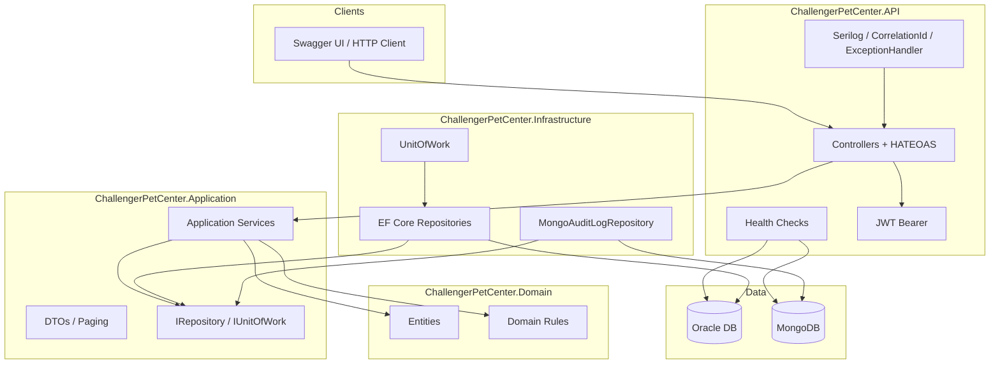

# README — Challenger Pet Center API
API de C# do projeto PetCenter para o Challenger2

Integrantes: 

   Arthur dos Santos Cabral, 566515, 2TDSA

   Bruno Martins Bettio, 564939, 2TDSA

   José Diogo da Silva Neves, 562341, 2TDSA 

   Júlia Tiziotto Buttler, 564975, 2TDSA 

   Mariana Xavier Quispe, 566357, 2TDSA 

# LINK DO REPOSITÓRIO: https://github.com/JuliaTButtler/ChallengerPetCenter.git

## Descrição do Projeto

O projeto consiste no desenvolvimento de uma API RESTful para uma plataforma de acompanhamento contínuo da saúde animal, com foco em transformar o cuidado com pets em um processo preventivo, organizado e integrado ao acompanhamento veterinário.

A proposta surgiu a partir da identificação de um problema recorrente: muitos tutores não possuem um histórico estruturado sobre a saúde do animal e frequentemente recorrem ao veterinário apenas em situações emergenciais. Isso dificulta a identificação de padrões comportamentais, reduz a precisão das análises clínicas e torna o cuidado animal majoritariamente reativo.

Como solução, a plataforma propõe a criação de um “diário inteligente do pet”, onde tutores podem registrar informações diárias sobre seus animais, permitindo um acompanhamento contínuo da rotina e da saúde do pet.

O sistema permite:

* Cadastro e gerenciamento de usuários (tutores e veterinários)
* Autenticação JWT (`/api/auth/login`, `/api/auth/me`, mutations protegidas)
* Cadastro de pets e vínculo pet–veterinário
* Diário do pet com registros diários (alimentação, sintomas, comportamento)
* Comentários e solicitações de acompanhamento
* Persistência **Oracle** (EF Core) + **MongoDB** (auditoria / NoSQL)
* Paginação, ordenação, filtros e **HATEOAS** nos endpoints de consulta
* Health Checks, logging estruturado (Serilog) e tracing/métricas (OpenTelemetry)
* Testes automatizados (unitários e de integração) com cobertura Domain + Application

O conceito principal da plataforma é transformar registros cotidianos em informações organizadas e úteis para acompanhamento clínico, criando um histórico contínuo da vida do animal.

Entrega consolidada (Sprints 1–4): Clean Architecture, API RESTful completa, Oracle + MongoDB, observabilidade e testes com cobertura das camadas de Domínio e Aplicação.

---

## Tecnologias Utilizadas

* ASP.NET Core Web API (.NET 8)
* Clean Architecture (Domain, Application, Infrastructure, API)
* Entity Framework Core + Oracle Entity Framework Core Provider
* MongoDB.Driver (auditoria NoSQL)
* Swagger / OpenAPI
* JWT Bearer (autenticação; sem ASP.NET Identity — opção “JWT ou Identity” da rubrica)
* Microsoft.Extensions.Diagnostics.HealthChecks
* Serilog (logging estruturado)
* OpenTelemetry (tracing e métricas — export console)
* xUnit / Moq / WebApplicationFactory / Coverlet
* C#

---

## Arquitetura (Clean Architecture)

A solução está separada em quatro projetos:

| Camada | Projeto | Responsabilidade |
|--------|---------|------------------|
| **Domain** | `ChallengerPetCenter.Domain` | Entidades, regras de domínio e exceções de negócio |
| **Application** | `ChallengerPetCenter.Application` | Services, DTOs, interfaces de repositório, Unit of Work |
| **Infrastructure** | `ChallengerPetCenter.Infrastructure` | EF Core (Oracle), MongoDB, repositórios concretos, health checks de infra |
| **API** | `ChallengerPetCenter.API` | Controllers, Swagger, JWT, middleware, HATEOAS, exception handler |

Dependências fluem **para dentro**: API → Application/Infrastructure; Infrastructure → Application/Domain; Application → Domain. O Domain não depende de nenhuma outra camada.

### Diagrama de arquitetura



---

## Paginação, ordenação, filtros e HATEOAS

Nos endpoints de **consulta** (GET de listagem e GET por id), a API retorna:

* **Listagens:** `PagedResponseDto` com `items`, `page`, `pageSize`, `total` e `_links` (`self`, `prev`, `next`, `create`)
* **Recurso único / create:** `ResourceResponseDto` com `data` e `_links` (`self`, `update`, `delete`)

Query params padrão nas listagens:

| Param | Descrição | Default |
|-------|-----------|---------|
| `page` | Página (1-based) | `1` |
| `pageSize` | Itens por página (máx. 100) | `10` (audit-logs: `20`) |
| `sort` | Campo de ordenação | varia por recurso |
| `order` | `asc` ou `desc` | `asc` / `desc` conforme recurso |

Filtros adicionais por recurso (query string), por exemplo:

* `/api/users?tipoUsuario=TUTOR`
* `/api/pets?especie=Gato&nome=Luna&userId=1`
* `/api/veterinarios?especialidade=Clínica Geral`
* `/api/registros?tipo=ALIMENTACAO&diarioEntradaId=12`
* `/api/solicitacoes?status=PENDENTE&tutorId=26`
* `/api/petveterinarios?ativo=1`
* `/api/audit-logs?entity=User&action=USER_CREATED`

Rotas filtradas legadas (`/api/pets/user/{userId}`, `/api/registros/tipo/{tipo}`, etc.) continuam disponíveis e também retornam o envelope paginado com HATEOAS.

---

## Persistência (Oracle + MongoDB)

* **Oracle (relacional):** Entity Framework Core, `AppDbContext`, migrations em `ChallengerPetCenter.Infrastructure/Migrations`, repositórios concretos + `UnitOfWork`.
* **MongoDB (NoSQL):** trilha de auditoria (`audit_logs`) via `MongoAuditLogRepository`; consulta em `GET /api/audit-logs`. Se `MongoConnection` estiver vazia, a API sobe com `NoOpAuditLogService` (auditoria desabilitada).

Connection strings em `appsettings.json`:

```json
"ConnectionStrings": {
  "OracleConnection": "User Id=...;Password=...;Data Source=...;",
  "MongoConnection": "mongodb://localhost:27017/PetCenter"
}
```

---

## Health Checks (Monitoramento)

A API expõe endpoints de saúde com `Microsoft.Extensions.Diagnostics.HealthChecks`:

| Endpoint | O que verifica |
|----------|----------------|
| `GET /health` ou `GET /healthz` | Todos os checks (visão geral) |
| `GET /health/live` | Processo da API (liveness / self) |
| `GET /health/ready` | Oracle + serviço externo (readiness) |

Checks registrados:

* **self** — API em execução
* **oracle** — conectividade com o banco via `AddDbContextCheck<AppDbContext>`
* **mongodb** — ping no MongoDB (quando `MongoConnection` está configurada)
* **external_service** — HTTP GET em URL configurável (`HealthChecks:ExternalServiceUrl` no `appsettings.json`). Se a URL estiver vazia, o check reporta Healthy com mensagem explicativa.

Exemplo de resposta JSON (status Healthy):

```json
{
  "status": "Healthy",
  "totalDuration": "00:00:00.12",
  "entries": {
    "self": { "status": "Healthy", "description": "API ChallengerPetCenter está em execução." },
    "oracle": { "status": "Healthy" },
    "external_service": { "status": "Healthy", "description": "Serviço externo respondendo: https://www.google.com (200)." }
  }
}
```

Como testar: com a API rodando (`dotnet run`), abra no navegador ou via curl:

```text
http://localhost:<porta>/health
http://localhost:<porta>/health/live
http://localhost:<porta>/health/ready
```

---

## Logging Estruturado (Serilog)

A API usa **Serilog** no lugar do logging padrão do ASP.NET Core.

### Saídas
* **Console** — durante `dotnet run`
* **Arquivo** — `logs/challenger-pet-center-YYYYMMDD.log` (rolling diário, retém 14 dias)

### Níveis
* Padrão da aplicação: **Information**
* Warnings/Erros de request HTTP: status `4xx` → Warning; `5xx` ou exception → Error
* Framework (`Microsoft.*`, EF Core): **Warning** (para reduzir ruído)

### Correlação de requisições
* Middleware `CorrelationIdMiddleware` gera ou propaga o header `X-Correlation-ID`
* Cada log inclui `CorrelationId` e `RequestId` (TraceIdentifier)
* `UseSerilogRequestLogging` registra método, path, status e tempo de resposta

### Como observar
1. Rode `dotnet run` e faça uma chamada (ex.: `/health` ou `/api/users`)
2. No console, veja linhas no formato: `[HH:mm:ss INF] (correlationId/requestId) HTTP GET /health respondeu 200 em ... ms`
3. Confira o mesmo conteúdo em `logs/challenger-pet-center-*.log`
4. Opcional: envie o header `X-Correlation-ID: meu-id-teste` e confira se ele aparece nos logs e na resposta

---

## OpenTelemetry (Tracing e Métricas)

Observabilidade **local**, sem Application Insights / cloud.

### O que está instrumentado
* **AspNetCore** — cada request HTTP gera um span (ex.: `GET /api/users`)
* **HttpClient** — chamadas externas (ex.: health check do Google) entram no mesmo fluxo de tracing

Rotas `/health*` e `/swagger*` são filtradas do tracing para reduzir ruído.

### Métricas
* Instrumentation AspNetCore/HttpClient (duração de request, contagem, erros)
* Exportadas no console a cada ~15 segundos

### Configuração (`appsettings.json`)
```json
"OpenTelemetry": {
  "ServiceName": "ChallengerPetCenter",
  "EnableConsoleExporters": true
}
```

### Como observar
1. `dotnet run`
2. Chame `GET /api/users` (ou outro endpoint de negócio)
3. No terminal, além do Serilog, aparecem blocos do exporter OpenTelemetry (Activity/spans e, periodicamente, métricas)

Não há dependência de collector OTLP nem de Azure nesta entrega.

---

## Autenticação JWT (mínima)

* `POST /api/auth/login` — email + senha → retorna Bearer token
* `GET /api/auth/me` — requer JWT (**401** sem token)
* `DELETE /api/users/{id}` — requer JWT

Configuração em `appsettings.json` (`Jwt:Key`, `Issuer`, `Audience`, `ExpirationMinutes`).

Cada login gera um token ligado àquele usuário (claims: id, email, tipo). O token vale até expirar (padrão 120 minutos); não há blacklist — apagar o usuário não invalida o token imediatamente.

> Observação: a senha ainda é comparada em texto puro (mínimo acadêmico). Hash seria evolução futura.

Veja o **Guia de testes manuais no Swagger** mais abaixo para exemplos completos de login e Authorize.

---

## Testes Automatizados

A solution inclui projetos separados por camada:

* `ChallengerPetCenter.UnitTests` — Domain (regras puras, sem EF/Moq) + Application (Moq dos repos) + Controllers
* `ChallengerPetCenter.IntegrationTests` — `WebApplicationFactory` + EF InMemory + Collection Fixture

Nomenclatura: `Metodo_Cenario_Resultado` (ex.: `CreateAsync_QuandoEmailJaExiste_RetornaFailure`). AAA visível em cada teste.

### O que é coberto

**Domain (unitário):** email inválido, diário duplicado no mesmo dia, pet sem tutor, usuário inativo.

**Application (Moq):** por agregado — create ok, create com regra, get not found, delete; Auth — ok / senha inválida / inativo. Inclui **Comentario** e **Registro**.

**Integração:** Users + Auth + Pets (HTTP com JWT); `401` sem token; `/health/live` e `/health/ready`.

```bash
dotnet test ChallengerPetCenter.sln
```

### Cobertura (Domain + Application)

Coletor apontado só para Domain/Application via `coverlet.runsettings` (Controllers/Program ficam de fora do alvo).

```bash
dotnet test ChallengerPetCenter.sln --collect:"XPlat Code Coverage" --settings coverlet.runsettings --results-directory ./TestResults
```

| Assembly | Line coverage |
|----------|---------------|
| `ChallengerPetCenter.Domain` | **94,9%** |
| `ChallengerPetCenter.Application` | **91,5%** |
| Combinado (Domain + Application) | **92,0%** |

**Importante:** use o relatório gerado pelo projeto **UnitTests** (Domain + Application ≈ **92%**). O Cobertura produzido só pelos IntegrationTests pode mostrar ~40% porque cobre menos código das camadas-alvo — não use esse arquivo como evidência de cobertura.

Relatório esperado: pasta em `TestResults/` correspondente à execução dos UnitTests (`coverage.cobertura.xml`).

Para testes manuais com exemplos de body, use a seção **Guia de testes manuais no Swagger**.

---

## Funcionalidades Implementadas

### Usuários

* Cadastro de usuários
* Consulta de usuários
* Atualização de usuários
* Remoção de usuários (requer JWT)

### Autenticação

* Login com JWT (`POST /api/auth/login`)
* Perfil autenticado (`GET /api/auth/me`)

### Veterinários

* Cadastro de veterinários
* Busca por CRMV
* Busca por especialidade
* Associação com usuários

### Pets

* Cadastro de pets
* Associação com tutores
* Consulta de pets

### Diário do Pet

* Criação de entradas diárias
* Organização cronológica
* Controle de uma entrada por pet por dia

### Registros

* Registros de alimentação
* Sintomas
* Comportamentos
* Atividades
* Observações complementares

### Comentários

* Comentários em entradas do diário
* Associação entre usuários e entradas

### Solicitações

* Solicitações entre tutores e veterinários
* Controle de status

### Relacionamento Pet-Veterinário

* Associação entre pets e veterinários
* Histórico de acompanhamento

### Auditoria (MongoDB)

* Gravação best-effort de ações de negócio
* Consulta paginada com filtros e HATEOAS em `GET /api/audit-logs`

### Monitoramento

* Health Checks (`/health`, `/health/live`, `/health/ready`) — Oracle, MongoDB e serviço externo
* Logging estruturado com Serilog (console + arquivo, CorrelationId)
* OpenTelemetry (tracing + métricas no console)
* JWT (login + endpoints protegidos)

---

## Objetivo da API

A API foi desenvolvida seguindo o padrão REST, utilizando boas práticas de:

* Clean Architecture + SOLID + injeção de dependência
* Controllers finos + Services + DTOs + repositórios
* Paginação, ordenação, filtros e HATEOAS nas consultas
* Oracle (EF Core) + MongoDB (auditoria)
* Documentação com Swagger/OpenAPI
* Observabilidade (Health Checks, Serilog, OpenTelemetry)
* Autenticação JWT
* Testes automatizados (unitários e integração) com cobertura Domain/Application

### Como subir a API

```bash
dotnet run
```

Swagger (perfil http): http://localhost:5032/swagger

### Como rodar os testes automatizados

```bash
dotnet test ChallengerPetCenter.sln
```

---

## Guia de testes manuais no Swagger (POST)

Use este fluxo na ordem. Em cada POST: abra o endpoint → **Try it out** → cole o JSON → **Execute**.  
Os IDs (`userId`, `petId`, etc.) devem ser os retornados nas respostas anteriores (não copie IDs inventados se o banco já tiver outros registros).

### Passo 1 — Criar tutor

`POST /api/users`

```json
{
  "nome": "Camila Ferreira",
  "email": "camila.ferreira@email.com",
  "senha": "Camila@2024",
  "telefone": "11987654321",
  "tipoUsuario": "TUTOR"
}
```

Espere **201**. Anote o `id` do tutor (ex.: `26`).

### Passo 2 — Criar usuário veterinário

`POST /api/users`

```json
{
  "nome": "Ricardo Almeida",
  "email": "ricardo.almeida@email.com",
  "senha": "Ricardo@2024",
  "telefone": "11976543210",
  "tipoUsuario": "VETERINARIO"
}
```

Anote o `id` do usuário veterinário (ex.: `27`).

### Passo 3 — Login (JWT)

`POST /api/auth/login`

```json
{
  "email": "camila.ferreira@email.com",
  "senha": "Camila@2024"
}
```

Copie o `token`. No Swagger, clique em **Authorize**, cole o token e confirme.  
Opcional: `GET /api/auth/me` deve retornar **200** com o email da Camila.

### Passo 4 — Perfil de veterinário

`POST /api/veterinarios`  
(substitua `userId` pelo id do Ricardo)

```json
{
  "crmv": "SP-45872",
  "especialidade": "Clínica Geral",
  "descricao": "Atendimento de cães e gatos, com foco em acompanhamento preventivo.",
  "userId": 27
}
```

Anote o `id` do veterinário (ex.: `5`).

### Passo 5 — Cadastrar o pet

`POST /api/pets`  
(substitua `userId` pelo id da Camila)

```json
{
  "nome": "Luna",
  "especie": "Gato",
  "raca": "Siamês",
  "dataNascimento": "2022-03-15T00:00:00",
  "observacoes": "Alimentação controlada e rotina de brincadeiras à noite.",
  "userId": 26
}
```

Anote o `id` do pet (ex.: `8`).

### Passo 6 — Vincular pet e veterinário

`POST /api/petveterinarios`

```json
{
  "petId": 8,
  "veterinarioId": 5,
  "dataInicio": "2026-09-01T10:00:00",
  "observacoes": "Acompanhamento mensal de rotina."
}
```

### Passo 7 — Entrada no diário

`POST /api/diarioentradas`

```json
{
  "data": "2026-09-11T00:00:00",
  "resumo": "Dia calmo em casa, brincou após o almoço.",
  "humorGeral": "TRANQUILO",
  "status": "ATIVO",
  "petId": 8
}
```

Anote o `id` da entrada (ex.: `12`).  
Regra: só **uma entrada por pet por dia**.

### Passo 8 — Registro do dia (alimentação)

`POST /api/registros`

```json
{
  "tipo": "ALIMENTACAO",
  "subtipo": "RACAO",
  "valor": 80,
  "unidade": "g",
  "nota": "Comeu bem a porção da manhã.",
  "horario": "2026-09-11T08:30:00",
  "diarioEntradaId": 12
}
```

Outro exemplo (sintoma):

```json
{
  "tipo": "SINTOMA",
  "subtipo": "APETITE",
  "valor": null,
  "unidade": null,
  "nota": "Apetite levemente reduzido no final da tarde.",
  "horario": "2026-09-11T17:00:00",
  "diarioEntradaId": 12
}
```

### Passo 9 — Comentário no diário

`POST /api/comentarios`  
(`userId` pode ser o da Camila ou do Ricardo)

```json
{
  "textoComentario": "Manter a rotina alimentar e observar o apetite pelos próximos dois dias.",
  "diarioEntradaId": 12,
  "userId": 27
}
```

### Passo 10 — Solicitação de acompanhamento

`POST /api/solicitacoes`  
(`tutorId` deve ser o dono do pet)

```json
{
  "status": "PENDENTE",
  "mensagem": "Gostaria de uma orientação sobre a mudança de apetite da Luna.",
  "petId": 8,
  "tutorId": 26,
  "veterinarioId": 5
}
```

Se `status` for omitido, a API assume `PENDENTE`.

### Cenários de erro úteis

| Ação | Body / situação | Esperado |
|------|-----------------|----------|
| Email duplicado | mesmo email da Camila em `POST /api/users` | **400** |
| Login errado | senha incorreta no login | **400** |
| `/api/auth/me` sem Authorize | — | **401** |
| Segunda entrada no mesmo dia | mesmo `petId` + mesma `data` | **400** |
| Solicitação com tutor errado | `tutorId` diferente do dono do pet | **400** |
| `DELETE /api/users/{id}` sem token | — | **401** |

### Campos dos POST (referência rápida)

| Endpoint | Campos |
|----------|--------|
| `POST /api/users` | `nome*`, `email*`, `senha*`, `telefone`, `tipoUsuario*` (`TUTOR` ou `VETERINARIO`) |
| `POST /api/auth/login` | `email*`, `senha*` |
| `POST /api/veterinarios` | `crmv*`, `especialidade`, `descricao`, `userId*` |
| `POST /api/pets` | `nome*`, `especie*`, `raca`, `dataNascimento`, `observacoes`, `userId*` |
| `POST /api/petveterinarios` | `petId*`, `veterinarioId*`, `dataInicio`, `observacoes` |
| `POST /api/diarioentradas` | `data*`, `resumo`, `humorGeral`, `status`, `petId*` |
| `POST /api/registros` | `tipo*`, `subtipo`, `valor`, `unidade`, `nota`, `horario`, `diarioEntradaId*` |
| `POST /api/comentarios` | `textoComentario*`, `diarioEntradaId*`, `userId*` |
| `POST /api/solicitacoes` | `status`, `mensagem`, `petId*`, `tutorId*`, `veterinarioId*` |

\* obrigatório

---

# Documentação das Rotas

---

# Usuários

### GET
`/api/users?page&pageSize&sort&order&tipoUsuario`
- Lista usuários (paginado + HATEOAS)

### GET
`/api/users/{id}`
- Busca usuário por ID (HATEOAS)

### GET
`/api/users/email/{email}`
- Busca usuário por email (HATEOAS)

### GET
`/api/users/tipo/{tipo}`
- Lista por tipo (paginado + HATEOAS)

### POST
`/api/users`
- Cria um novo usuário (público)

### PUT / DELETE
`/api/users/{id}`
- Atualiza / remove (**requer JWT**)

---

# Auth

### POST
`/api/auth/login`
- Autentica e retorna JWT

### GET
`/api/auth/me`
- Dados do usuário autenticado (**requer JWT**)

---

# Veterinários

### GET
`/api/veterinarios?page&pageSize&sort&order&especialidade&userId`
- Lista veterinários (paginado + HATEOAS)

### GET
`/api/veterinarios/{id}` · `/crmv/{crmv}` · `/user/{userId}`
- Recurso único (HATEOAS)

### GET
`/api/veterinarios/especialidade/{especialidade}`
- Lista filtrada (paginado + HATEOAS)

### POST / PUT / DELETE
- Mutations (**requer JWT**)

---

# Pets

### GET
`/api/pets?page&pageSize&sort&order&especie&nome&userId`
- Lista pets (paginado + HATEOAS)

### GET
`/api/pets/{id}`
- Busca pet por ID (HATEOAS)

### GET
`/api/pets/user/{userId}` · `/especie/{especie}` · `/nome/{nome}`
- Listas filtradas (paginado + HATEOAS)

### POST / PUT / DELETE
- Mutations (**requer JWT**)

---

# Diário de Entradas

### GET
`/api/diarioentradas?page&pageSize&sort&order&status&humor&petId`
- Lista entradas (paginado + HATEOAS)

### GET
`/api/diarioentradas/{id}`
- Busca por ID (HATEOAS)

### GET
`/api/diarioentradas/pet/{petId}` · `/status/{status}`
- Listas filtradas (paginado + HATEOAS)

### POST / PUT / DELETE
- Mutations (**requer JWT**)

---

# Comentários

### GET
`/api/comentarios?page&pageSize&sort&order&diarioEntradaId&userId&texto`
- Lista comentários (paginado + HATEOAS)

### GET
`/api/comentarios/{id}`
- Busca por ID (HATEOAS)

### GET
`/api/comentarios/diario/{diarioEntradaId}` · `/user/{userId}` · `/texto/{texto}`
- Listas filtradas (paginado + HATEOAS)

### POST / PUT / DELETE
- Mutations (**requer JWT**)

---

# Registros

### GET
`/api/registros?page&pageSize&sort&order&tipo&subtipo&diarioEntradaId`
- Lista registros (paginado + HATEOAS)

### GET
`/api/registros/{id}`
- Busca por ID (HATEOAS)

### GET
`/api/registros/diario/{diarioEntradaId}` · `/tipo/{tipo}` · `/subtipo/{subtipo}`
- Listas filtradas (paginado + HATEOAS)

### POST / PUT / DELETE
- Mutations (**requer JWT**)

---

# Solicitações

### GET
`/api/solicitacoes?page&pageSize&sort&order&status&petId&tutorId&veterinarioId`
- Lista solicitações (paginado + HATEOAS)

### GET
`/api/solicitacoes/{id}`
- Busca por ID (HATEOAS)

### GET
`/api/solicitacoes/pet/{petId}` · `/tutor/{tutorId}` · `/veterinario/{veterinarioId}` · `/status/{status}`
- Listas filtradas (paginado + HATEOAS)

### POST / PUT / DELETE
- Mutations (**requer JWT**)

---

# Relacionamento Pet-Veterinário

### GET
`/api/petveterinarios?page&pageSize&sort&order&petId&veterinarioId&ativo`
- Lista vínculos (paginado + HATEOAS)

### GET
`/api/petveterinarios/{id}`
- Busca por ID (HATEOAS)

### GET
`/api/petveterinarios/pet/{petId}` · `/veterinario/{veterinarioId}` · `/ativos`
- Listas filtradas (paginado + HATEOAS)

### POST / PUT / DELETE
- Mutations (**requer JWT**)

---

# Audit Logs (MongoDB)

### GET
`/api/audit-logs?entity&entityId&action&page&pageSize`
- Consulta auditoria NoSQL (paginado + HATEOAS `_links`)

---

# Swagger / OpenAPI

Com a API em execução, a documentação interativa fica em:

http://localhost:5032/swagger

(Perfil HTTPS conforme `launchSettings.json`.) O Swagger descreve schemas, query params de paginação/filtros e autenticação Bearer.

---

# Instalação e Execução

## Pré-requisitos

- .NET 8 SDK
- Visual Studio 2022 (opcional) ou VS Code / Rider
- Oracle Database (ou acesso ao Oracle da FIAP)
- MongoDB local ou remoto (opcional; sem connection string a auditoria fica NoOp)
- Oracle SQL Developer (opcional, para inspecionar tabelas)

---

# Clonar o repositório

```bash
git clone https://github.com/JuliaTButtler/ChallengerPetCenter.git
cd ChallengerPetCenter
```

---

# Configurar conexões

Edite `ChallengerPetCenter.API/appsettings.json` (ou `appsettings.Development.json`):

```json
"ConnectionStrings": {
  "OracleConnection": "User Id=SEU_USUARIO;Password=SUA_SENHA;Data Source=localhost:1521/XEPDB1;",
  "MongoConnection": "mongodb://localhost:27017/PetCenter"
}
```

---

# Executar as migrations

As migrations já existem em `ChallengerPetCenter.Infrastructure/Migrations`. Para aplicar no banco:

```bash
dotnet ef database update --project ChallengerPetCenter.Infrastructure --startup-project ChallengerPetCenter.API
```

---

# Executar a aplicação

```bash
dotnet run --project ChallengerPetCenter.API
```

Ou F5 no Visual Studio (perfil http/https).

Swagger: http://localhost:5032/swagger

---

# Estrutura do Projeto

```text
ChallengerPetCenter/
├── ChallengerPetCenter.Domain/          # Entidades e regras
├── ChallengerPetCenter.Application/     # Services, DTOs, abstrações
├── ChallengerPetCenter.Infrastructure/  # EF/Oracle, Mongo, repositórios
├── ChallengerPetCenter.API/             # Controllers, JWT, health, Swagger
├── ChallengerPetCenter.UnitTests/
├── ChallengerPetCenter.IntegrationTests/
├── coverlet.runsettings
└── README.md
```

---

# Observações

* Clean Architecture com DI, tratamento global de exceções e padrão Repository.
* Oracle (relacional) + MongoDB (auditoria NoSQL).
* Consultas com paginação/ordenação/filtros e HATEOAS (`_links`).
* Autenticação via JWT Bearer (sem ASP.NET Identity).
* Cobertura Domain/Application: use o relatório dos **UnitTests** (~92%).


