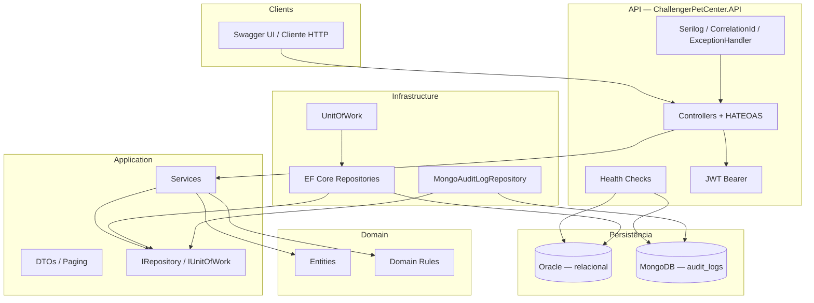

# Challenger Pet Center API

API RESTful em ASP.NET Core (.NET 8) para acompanhamento contínuo da saúde animal — diário do pet, vínculo tutor–veterinário e histórico clínico organizado.

**Repositório:** https://github.com/JuliaTButtler/ChallengerPetCenter.git

---

## Integrantes

| Nome | RM | Turma |
|------|-----|-------|
| Arthur dos Santos Cabral | 566515 | 2TDSA |
| Bruno Martins Bettio | 564939 | 2TDSA |
| José Diogo da Silva Neves | 562341 | 2TDSA |
| Júlia Tiziotto Buttler | 564975 | 2TDSA |
| Mariana Xavier Quispe | 566357 | 2TDSA |

---

## Sumário

1. [Visão geral](#1-visão-geral)
2. [Arquitetura](#2-arquitetura)
3. [Instalação e execução](#3-instalação-e-execução)
4. [MongoDB (auditoria NoSQL)](#4-mongodb-auditoria-nosql)
5. [Autenticação JWT](#5-autenticação-jwt)
6. [Paginação, filtros e HATEOAS](#6-paginação-filtros-e-hateoas)
7. [Documentação dos endpoints](#7-documentação-dos-endpoints)
8. [Guia de testes no Swagger](#8-guia-de-testes-no-swagger)
9. [Testes automatizados e cobertura](#9-testes-automatizados-e-cobertura)
10. [Observabilidade](#10-observabilidade)

---

## 1. Visão geral

### Contexto e problema

O Challenger Pet Center nasceu da observação de um problema recorrente no cuidado animal: muitos tutores **não mantêm um histórico estruturado** da saúde e da rotina do pet. Informações sobre alimentação, sintomas, humor e comportamento ficam espalhadas em anotações improvisadas ou simplesmente se perdem. Na prática, o veterinário só é acionado em situações emergenciais, o que reduz a qualidade das análises clínicas e torna o cuidado majoritariamente **reativo**, em vez de preventivo.

Sem um registro contínuo, fica difícil identificar padrões (queda de apetite, mudanças de humor, recorrência de sintomas) e construir um acompanhamento compartilhado entre tutor e profissional.

### Solução proposta

A solução é uma **API RESTful** que implementa o conceito de **diário inteligente do pet**: uma plataforma de acompanhamento contínuo em que tutores registram informações diárias e veterinários acompanham o histórico de forma organizada.

A API concentra o domínio de negócio (usuários, pets, diário, registros, comentários, solicitações e vínculos pet–veterinário), expõe contratos HTTP documentados via Swagger/OpenAPI e persiste:

* dados transacionais no **Oracle** (Entity Framework Core + migrations);
* trilha de auditoria no **MongoDB** (collection `audit_logs`), como uso de persistência NoSQL.

O objetivo é transformar registros cotidianos em informação útil para acompanhamento clínico, criando um histórico contínuo da vida do animal e facilitando a comunicação tutor ↔ veterinário.

### O que a plataforma permite

* Cadastro e gerenciamento de **usuários** (tutores e veterinários) com autenticação **JWT**
* Cadastro de **pets** vinculados a tutores
* Perfil de **veterinário** (CRMV, especialidade) associado a um usuário
* **Vínculo pet–veterinário** com histórico de acompanhamento
* **Diário do pet** (uma entrada por pet por dia), com humor e status
* **Registros** do dia (alimentação, sintomas, comportamento, etc.)
* **Comentários** em entradas do diário
* **Solicitações** de acompanhamento entre tutor e veterinário
* Consultas com **paginação, ordenação, filtros e HATEOAS**
* **Auditoria NoSQL** das operações de negócio no MongoDB
* **Health Checks**, logging estruturado (Serilog) e tracing/métricas (OpenTelemetry)
* **Testes** unitários e de integração com cobertura das camadas Domain e Application

### Evolução por sprints

| Sprint | Foco |
|--------|------|
| **1-2** | API REST inicial, Oracle + EF Core, Swagger, CRUDs das entidades principais |
| **3** | Camadas/serviços/DTOs, JWT, Health Checks, Serilog, OpenTelemetry, testes |
| **4** | Consolidação: Clean Architecture, HATEOAS + paginação/filtros em todas as consultas, MongoDB (auditoria), cobertura de testes Domain/Application, README final |

Esta entrega (Sprint 4) consolida o projeto **completo e funcional**, com os tópicos das sprints anteriores integrados e documentados.

### Escopo técnico da entrega

| Área | O que foi entregue |
|------|--------------------|
| Arquitetura | Clean Architecture (Domain / Application / Infrastructure / API), SOLID, DI, exception handler global |
| API REST | CRUD completo, Swagger/OpenAPI, paginação, ordenação, filtros, HATEOAS |
| Auth | JWT Bearer (login, `/me`, mutations protegidas) — opção “JWT ou Identity” da rubrica |
| Persistência | EF Core + migrations Oracle; MongoDB para `audit_logs`; padrão Repository + Unit of Work |
| Observabilidade | Health Checks (self, Oracle, Mongo, serviço externo), Serilog, OpenTelemetry |
| Testes | xUnit (unitários + integração), padrão AAA, Coverlet Domain + Application (~92%) |
| Documentação | README (visão geral, arquitetura, endpoints, instalação, testes, integrantes) + diagrama + Swagger |

### Fora do escopo (futuro)

Funcionalidades de inteligência artificial (insights automáticos), IoT e app mobile **não** fazem parte desta entrega; ficam como evolução planejada do produto.

### Tecnologias

* ASP.NET Core Web API (.NET 8) e C#
* Clean Architecture (Domain, Application, Infrastructure, API)
* Entity Framework Core + Oracle EF Core Provider
* MongoDB.Driver (auditoria NoSQL)
* Swagger / OpenAPI
* JWT Bearer
* Serilog (logging estruturado) e OpenTelemetry (tracing/métricas)
* Microsoft.Extensions.Diagnostics.HealthChecks
* xUnit, Moq, WebApplicationFactory, Coverlet

---

## 2. Arquitetura

### Camadas

| Camada | Projeto | Responsabilidade |
|--------|---------|------------------|
| **Domain** | `ChallengerPetCenter.Domain` | Entidades, regras de domínio, exceções de negócio |
| **Application** | `ChallengerPetCenter.Application` | Services, DTOs, interfaces de repositório, Unit of Work |
| **Infrastructure** | `ChallengerPetCenter.Infrastructure` | EF Core (Oracle), MongoDB, repositórios concretos, health checks |
| **API** | `ChallengerPetCenter.API` | Controllers, Swagger, JWT, middleware, HATEOAS, exception handler |
| **Testes** | `UnitTests` / `IntegrationTests` | Cobertura Domain/Application + smoke HTTP |

Dependências fluem **para dentro**: API → Application/Infrastructure; Infrastructure → Application/Domain; Application → Domain. O Domain não referencia outras camadas.

### Diagrama de arquitetura



### Estrutura de pastas

```text
ChallengerPetCenter/
├── ChallengerPetCenter.Domain/
├── ChallengerPetCenter.Application/
├── ChallengerPetCenter.Infrastructure/
│   ├── Migrations/          # EF Core (Oracle)
│   ├── Mongo/               # documentos e settings
│   └── Repositories/        # EF + MongoAuditLogRepository
├── ChallengerPetCenter.API/
│   ├── Controllers/
│   ├── Hateoas/
│   ├── HealthChecks/
│   └── Exceptions/
├── ChallengerPetCenter.UnitTests/
├── ChallengerPetCenter.IntegrationTests/
├── coverlet.runsettings
└── README.md
```

---

## 3. Instalação e execução

### Pré-requisitos

* .NET 8 SDK
* Visual Studio 2022 / VS Code / Rider (opcional)
* Oracle Database (local ou Oracle FIAP)
* MongoDB Community (local) ou MongoDB Atlas — para auditoria
* Oracle SQL Developer / MongoDB Compass (opcional, inspeção)

### Clonar

```bash
git clone https://github.com/JuliaTButtler/ChallengerPetCenter.git
cd ChallengerPetCenter
```

### Configurar conexões

Edite `ChallengerPetCenter.API/appsettings.json` (ou `appsettings.Development.json`):

```json
"ConnectionStrings": {
  "OracleConnection": "User Id=SEU_USUARIO;Password=SUA_SENHA;Data Source=localhost:1521/XEPDB1;",
  "MongoConnection": "mongodb://localhost:27017/PetCenter"
}
```

> Se `MongoConnection` estiver vazia, a API sobe normalmente com auditoria **NoOp** (não grava no Mongo).

### Migrations (Oracle)

```bash
dotnet ef database update --project ChallengerPetCenter.Infrastructure --startup-project ChallengerPetCenter.API
```

### Rodar a API

```bash
dotnet run --project ChallengerPetCenter.API --launch-profile http
```

| Recurso | URL |
|---------|-----|
| Swagger UI | http://localhost:5032/swagger |
| OpenAPI JSON | http://localhost:5032/swagger/v1/swagger.json |
| Health | http://localhost:5032/health |

---

## 4. MongoDB (auditoria NoSQL)

### Como funciona

1. Operações de negócio (create/update/delete em Users, Pets, Veterinários, etc.) chamam `IAuditLogService.WriteAsync` de forma **best-effort** (falha no Mongo **não** derruba o CRUD).
2. A Infrastructure grava documentos na collection **`audit_logs`** do database **`PetCenter`** via `MongoAuditLogRepository`.
3. A consulta é pública via `GET /api/audit-logs` (paginação, filtros e HATEOAS).
4. Health Check `mongodb` faz ping quando a connection string está configurada.

Campos típicos do documento:

| Campo | Exemplo |
|-------|---------|
| `Action` | `USER_CREATED`, `PET_CREATED`, `VETERINARIO_CREATED` |
| `Entity` | `User`, `Pet`, `Veterinario` |
| `EntityId` | `"62"` |
| `OccurredAt` | data/hora UTC |
| `PayloadJson` | resumo JSON da operação |

### Como testar o Mongo

**A) Pela API **

1. Suba o Mongo e a API com `MongoConnection` preenchida.
2. Abra http://localhost:5032/health e confira `mongodb` = **Healthy**.
3. Faça POSTs no Swagger (criar user/pet etc.).
4. Chame:

```http
GET /api/audit-logs?page=1&pageSize=10
GET /api/audit-logs?entity=User
GET /api/audit-logs?action=PET_CREATED
```

Resposta esperada: `items`, `page`, `pageSize`, `total`, `_links`.

**B) Pelo MongoDB Compass**

1. Conecte em `mongodb://localhost:27017`.
2. Database **`PetCenter`** → collection **`audit_logs`**.
3. Após os POSTs, clique em **Refresh** (o Compass não atualiza sozinho).
4. Filtro opcional: `{ "Action": "USER_CREATED" }` — sort: `{ "OccurredAt": -1 }`.

Os mesmos eventos devem aparecer no Compass e no `GET /api/audit-logs`.

---

## 5. Autenticação JWT

* `POST /api/auth/login` — público; retorna `token`
* `GET /api/auth/me` — requer JWT
* Mutations (POST/PUT/DELETE de negócio, exceto criar usuário) — requerem JWT
* `POST /api/users` — **público** (cadastro)

Configuração: seção `Jwt` no `appsettings.json` (`Key`, `Issuer`, `Audience`, `ExpirationMinutes`).

> Autenticação via **JWT Bearer** (sem ASP.NET Identity), atendendo o requisito “JWT ou Identity”.

### Authorize no Swagger

1. Execute o login e copie **somente** o valor de `token` (string `eyJ...`).
2. Clique no cadeado **Authorize**.
3. Cole o token **sem** escrever `Bearer ` na frente (o Swagger já adiciona).
4. Authorize → Close.
5. Teste `GET /api/auth/me` → deve retornar **200**.

Erro comum: colar `Bearer eyJ...` → vira `Bearer Bearer ...` → **401 invalid_token**.

---

## 6. Paginação, filtros e HATEOAS

### Listagens (`GET` de coleção)

Envelope:

```json
{
  "items": [ ... ],
  "page": 1,
  "pageSize": 10,
  "total": 5,
  "_links": [
    { "rel": "self", "href": "/api/users?page=1&pageSize=10&sort=id&order=asc", "method": "GET" },
    { "rel": "create", "href": "/api/users", "method": "POST" }
  ]
}
```

Com `pageSize` menor que o `total`, aparecem também `next` / `prev`.

Query params comuns: `page`, `pageSize` (máx. 100), `sort`, `order`, mais filtros por recurso.

### Recurso único / create

```json
{
  "data": { "id": 23, "nome": "Shouko", ... },
  "_links": [
    { "rel": "self", "href": "/api/users/23", "method": "GET" },
    { "rel": "update", "href": "/api/users/23", "method": "PUT" },
    { "rel": "delete", "href": "/api/users/23", "method": "DELETE" }
  ]
}
```

Todos os endpoints de consulta principais (Users, Pets, Veterinários, Diário, Comentários, Registros, Solicitações, PetVeterinários, Audit Logs) usam esse padrão.

---

## 7. Documentação dos endpoints

Documentação interativa e schemas: **http://localhost:5032/swagger**  
Especificação OpenAPI exportável: **http://localhost:5032/swagger/v1/swagger.json** (salvar a página / baixar o JSON).

### Auth

| Método | Rota | Auth | Descrição |
|--------|------|------|-----------|
| POST | `/api/auth/login` | Não | Login → JWT |
| GET | `/api/auth/me` | Sim | Usuário autenticado |

### Users

| Método | Rota | Auth | Descrição |
|--------|------|------|-----------|
| GET | `/api/users?page&pageSize&sort&order&tipoUsuario` | Não | Lista paginada + HATEOAS |
| GET | `/api/users/{id}` | Não | Por ID + HATEOAS |
| GET | `/api/users/email/{email}` | Não | Por email |
| GET | `/api/users/tipo/{tipo}` | Não | Lista filtrada |
| POST | `/api/users` | Não | Criar |
| PUT | `/api/users/{id}` | Sim | Atualizar |
| DELETE | `/api/users/{id}` | Sim | Remover |

### Veterinários

| Método | Rota | Auth | Descrição |
|--------|------|------|-----------|
| GET | `/api/veterinarios?...&especialidade&userId` | Não | Lista + HATEOAS |
| GET | `/api/veterinarios/{id}` · `/crmv/{crmv}` · `/user/{userId}` | Não | Recurso |
| GET | `/api/veterinarios/especialidade/{especialidade}` | Não | Lista filtrada |
| POST / PUT / DELETE | `/api/veterinarios` · `/{id}` | Sim | Mutations |

### Pets

| Método | Rota | Auth | Descrição |
|--------|------|------|-----------|
| GET | `/api/pets?...&especie&nome&userId` | Não | Lista + HATEOAS |
| GET | `/api/pets/{id}` | Não | Por ID |
| GET | `/api/pets/user/{userId}` · `/especie/{especie}` · `/nome/{nome}` | Não | Filtros |
| POST / PUT / DELETE | `/api/pets` · `/{id}` | Sim | Mutations |

### Diário de Entradas

| Método | Rota | Auth | Descrição |
|--------|------|------|-----------|
| GET | `/api/diarioentradas?page&pageSize&sort&order&status&humor&petId` | Não | Lista paginada + HATEOAS |
| GET | `/api/diarioentradas/{id}` | Não | Por ID + HATEOAS |
| GET | `/api/diarioentradas/pet/{petId}` | Não | Lista filtrada por pet |
| GET | `/api/diarioentradas/status/{status}` | Não | Lista filtrada por status |
| POST | `/api/diarioentradas` | Sim | Criar (1 entrada por pet/dia) |
| PUT | `/api/diarioentradas/{id}` | Sim | Atualizar |
| DELETE | `/api/diarioentradas/{id}` | Sim | Remover |

### Registros

| Método | Rota | Auth | Descrição |
|--------|------|------|-----------|
| GET | `/api/registros?page&pageSize&sort&order&tipo&subtipo&diarioEntradaId` | Não | Lista paginada + HATEOAS |
| GET | `/api/registros/{id}` | Não | Por ID + HATEOAS |
| GET | `/api/registros/diario/{diarioEntradaId}` | Não | Lista da entrada do diário |
| GET | `/api/registros/tipo/{tipo}` | Não | Lista filtrada por tipo |
| GET | `/api/registros/subtipo/{subtipo}` | Não | Lista filtrada por subtipo |
| POST | `/api/registros` | Sim | Criar |
| PUT | `/api/registros/{id}` | Sim | Atualizar |
| DELETE | `/api/registros/{id}` | Sim | Remover |

### Comentários

| Método | Rota | Auth | Descrição |
|--------|------|------|-----------|
| GET | `/api/comentarios?page&pageSize&sort&order&diarioEntradaId&userId&texto` | Não | Lista paginada + HATEOAS |
| GET | `/api/comentarios/{id}` | Não | Por ID + HATEOAS |
| GET | `/api/comentarios/diario/{diarioEntradaId}` | Não | Lista da entrada do diário |
| GET | `/api/comentarios/user/{userId}` | Não | Lista por usuário |
| GET | `/api/comentarios/texto/{texto}` | Não | Lista por texto |
| POST | `/api/comentarios` | Sim | Criar |
| PUT | `/api/comentarios/{id}` | Sim | Atualizar |
| DELETE | `/api/comentarios/{id}` | Sim | Remover |

### Solicitações

| Método | Rota | Auth | Descrição |
|--------|------|------|-----------|
| GET | `/api/solicitacoes?page&pageSize&sort&order&status&petId&tutorId&veterinarioId` | Não | Lista paginada + HATEOAS |
| GET | `/api/solicitacoes/{id}` | Não | Por ID + HATEOAS |
| GET | `/api/solicitacoes/pet/{petId}` | Não | Lista por pet |
| GET | `/api/solicitacoes/tutor/{tutorId}` | Não | Lista por tutor |
| GET | `/api/solicitacoes/veterinario/{veterinarioId}` | Não | Lista por veterinário |
| GET | `/api/solicitacoes/status/{status}` | Não | Lista por status |
| POST | `/api/solicitacoes` | Sim | Criar |
| PUT | `/api/solicitacoes/{id}` | Sim | Atualizar |
| DELETE | `/api/solicitacoes/{id}` | Sim | Remover |

### Relacionamento Pet–Veterinário

| Método | Rota | Auth | Descrição |
|--------|------|------|-----------|
| GET | `/api/petveterinarios?page&pageSize&sort&order&petId&veterinarioId&ativo` | Não | Lista paginada + HATEOAS |
| GET | `/api/petveterinarios/{id}` | Não | Por ID + HATEOAS |
| GET | `/api/petveterinarios/pet/{petId}` | Não | Vínculos do pet |
| GET | `/api/petveterinarios/veterinario/{veterinarioId}` | Não | Vínculos do veterinário |
| GET | `/api/petveterinarios/ativos` | Não | Somente vínculos ativos |
| POST | `/api/petveterinarios` | Sim | Criar vínculo |
| PUT | `/api/petveterinarios/{id}` | Sim | Atualizar |
| DELETE | `/api/petveterinarios/{id}` | Sim | Remover |

### Audit Logs (MongoDB)

| Método | Rota | Auth | Descrição |
|--------|------|------|-----------|
| GET | `/api/audit-logs?entity&entityId&action&page&pageSize` | Não | Consulta NoSQL + HATEOAS |

### Health

| Método | Rota | Descrição |
|--------|------|-----------|
| GET | `/health` · `/healthz` | Todos os checks |
| GET | `/health/live` | Liveness (self) |
| GET | `/health/ready` | Readiness (Oracle, Mongo se configurado, external) |

---

## 8. Guia de testes no Swagger

Ordem sugerida. Em cada POST: **Try it out** → cole o JSON → **Execute**.  
**Anote os IDs** retornados (`data.id`) — não use IDs de exemplo se o seu banco for outro.

### Checklist rápido (demo / professor)

1. `dotnet test ChallengerPetCenter.sln` → verde  
2. `/health` → `oracle` + `mongodb` Healthy  
3. `GET /api/users?page=1&pageSize=2` → `items` + `_links` (com `next` se houver mais de 2)  
4. Login → Authorize (só o token) → `GET /api/auth/me` → 200  
5. Fluxo de POSTs abaixo → `GET /api/audit-logs` → eventos no Mongo/Compass  
6. Mutation sem token → **401**

---

### Passo 1 — Criar tutor

`POST /api/users`

```json
{
  "nome": "Camila Ferreira",
  "email": "camila.demo@email.com",
  "senha": "Camila@2024",
  "telefone": "11987654321",
  "tipoUsuario": "TUTOR"
}
```

Esperado: **201** com `data` + `_links`. Anote o `id` do tutor.

### Passo 2 — Criar usuário veterinário

`POST /api/users`

```json
{
  "nome": "Ricardo Almeida",
  "email": "ricardo.demo@email.com",
  "senha": "Ricardo@2024",
  "telefone": "11976543210",
  "tipoUsuario": "VETERINARIO"
}
```

Anote o `id` do usuário veterinário.

### Passo 3 — Login (JWT)

`POST /api/auth/login`

```json
{
  "email": "camila.demo@email.com",
  "senha": "Camila@2024"
}
```

Copie o `token` → **Authorize** (sem `Bearer `) → `GET /api/auth/me` → **200**.

### Passo 4 — Perfil de veterinário (requer JWT)

`POST /api/veterinarios`  
(substitua `userId` pelo id do Ricardo)

```json
{
  "crmv": "SP-45872",
  "especialidade": "Clínica Geral",
  "descricao": "Atendimento de cães e gatos, com foco em acompanhamento preventivo.",
  "userId": 63
}
```

Anote o `id` do veterinário.

### Passo 5 — Cadastrar o pet (requer JWT)

`POST /api/pets`  
(substitua `userId` pelo id da Camila)

```json
{
  "nome": "Luna",
  "especie": "Gato",
  "raca": "Siamês",
  "dataNascimento": "2022-03-15T00:00:00",
  "observacoes": "Alimentação controlada e rotina de brincadeiras à noite.",
  "userId": 62
}
```

Anote o `id` do pet.

### Passo 6 — Vincular pet e veterinário (requer JWT)

`POST /api/petveterinarios`

```json
{
  "petId": 21,
  "veterinarioId": 21,
  "dataInicio": "2026-11-03T10:00:00",
  "observacoes": "Acompanhamento mensal de rotina."
}
```

> Troque `petId` / `veterinarioId` pelos IDs reais dos passos 4 e 5.

### Passo 7 — Entrada no diário (requer JWT)

`POST /api/diarioentradas`

```json
{
  "data": "2026-11-03T00:00:00",
  "resumo": "Dia calmo em casa, brincou após o almoço.",
  "humorGeral": "TRANQUILO",
  "status": "ATIVO",
  "petId": 21
}
```

Regra: **uma entrada por pet por dia**. Anote o `id` da entrada.

### Passo 8 — Registro do dia (requer JWT)

`POST /api/registros`

```json
{
  "tipo": "ALIMENTACAO",
  "subtipo": "RACAO",
  "valor": 80,
  "unidade": "g",
  "nota": "Comeu bem a porção da manhã.",
  "horario": "2026-11-03T08:30:00",
  "diarioEntradaId": 21
}
```

### Passo 9 — Comentário (requer JWT)

`POST /api/comentarios`

```json
{
  "textoComentario": "Manter a rotina alimentar e observar o apetite pelos próximos dois dias.",
  "diarioEntradaId": 21,
  "userId": 63
}
```

### Passo 10 — Solicitação (requer JWT)

`POST /api/solicitacoes`  
(`tutorId` = dono do pet)

```json
{
  "status": "PENDENTE",
  "mensagem": "Gostaria de uma orientação sobre a mudança de apetite da Luna.",
  "petId": 21,
  "tutorId": 62,
  "veterinarioId": 21
}
```

### Passo 11 — Validar HATEOAS / paginação

```http
GET /api/users?page=1&pageSize=2&sort=nome&order=asc
GET /api/pets?especie=Gato
GET /api/veterinarios?especialidade=Clínica Geral
GET /api/users/62
```

Confira `items`/`total`/`_links` nas listas e `data`/`_links` no GET por id.

### Passo 12 — Validar Mongo / audit logs

```http
GET /api/audit-logs?page=1&pageSize=10
GET /api/audit-logs?entity=User&action=USER_CREATED
```

Opcional: Compass → `PetCenter.audit_logs` → Refresh.

### Cenários de erro

| Situação | Esperado |
|----------|----------|
| Email duplicado no `POST /api/users` | **400** |
| Login com senha errada | **400** |
| `/api/auth/me` sem Authorize | **401** |
| `POST /api/pets` sem token | **401** |
| Segunda entrada no mesmo dia/pet | **400** |
| Solicitação com `tutorId` ≠ dono do pet | **400** |

### Campos dos POST (referência)

| Endpoint | Campos |
|----------|--------|
| `POST /api/users` | `nome*`, `email*`, `senha*`, `telefone`, `tipoUsuario*` (`TUTOR` \| `VETERINARIO`) |
| `POST /api/auth/login` | `email*`, `senha*` |
| `POST /api/veterinarios` | `crmv*`, `especialidade`, `descricao`, `userId*` |
| `POST /api/pets` | `nome*`, `especie*`, `raca`, `dataNascimento`, `observacoes`, `userId*` |
| `POST /api/petveterinarios` | `petId*`, `veterinarioId*`, `dataInicio`, `observacoes` |
| `POST /api/diarioentradas` | `data*`, `resumo`, `humorGeral`, `status`, `petId*` |
| `POST /api/registros` | `tipo*`, `subtipo`, `valor`, `unidade`, `nota`, `horario`, `diarioEntradaId*` |
| `POST /api/comentarios` | `textoComentario*`, `diarioEntradaId*`, `userId*` |
| `POST /api/solicitacoes` | `status`, `mensagem`, `petId*`, `tutorId*`, `veterinarioId*` |

\* obrigatório

---

## 9. Testes automatizados e cobertura

### Projetos

* **UnitTests** — Domain (regras) + Application (Moq) + alguns controllers; padrão AAA; nomes `Metodo_Cenario_Resultado`
* **IntegrationTests** — `WebApplicationFactory`, EF InMemory; Users, Auth, Pets, Health

```bash
dotnet test ChallengerPetCenter.sln
```

### Cobertura (Domain + Application)

```bash
dotnet test ChallengerPetCenter.UnitTests --collect:"XPlat Code Coverage" --settings coverlet.runsettings --results-directory ./TestResults
```

| Assembly | Line coverage |
|----------|---------------|
| `ChallengerPetCenter.Domain` | **94,9%** |
| `ChallengerPetCenter.Application` | **91,5%** |
| Combinado | **92,0%** |

Use o `coverage.cobertura.xml` gerado pelos **UnitTests**. Relatório só dos IntegrationTests pode mostrar ~40% e **não** deve ser usado como evidência.

---

## 10. Observabilidade

### Health Checks

* `self`, `oracle`, `mongodb` (se configurado), `external_service`
* Endpoints: `/health`, `/health/live`, `/health/ready`

### Serilog

* Console + arquivo `logs/challenger-pet-center-YYYYMMDD.log`
* Header `X-Correlation-ID` propagado nos logs e na resposta

### OpenTelemetry

* Tracing e métricas AspNetCore/HttpClient exportados no console (sem cloud)

---

## Observações finais

* Clean Architecture, DI, exception handler global e Repository pattern.
* Oracle (relacional) + MongoDB (auditoria NoSQL).
* Consultas com paginação, ordenação, filtros e HATEOAS (`_links`).
* Autenticação JWT Bearer (sem ASP.NET Identity).
* Swagger UI + OpenAPI JSON em `/swagger` e `/swagger/v1/swagger.json`.
* Cobertura Domain/Application ~92% (UnitTests + Coverlet).
